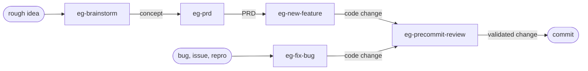
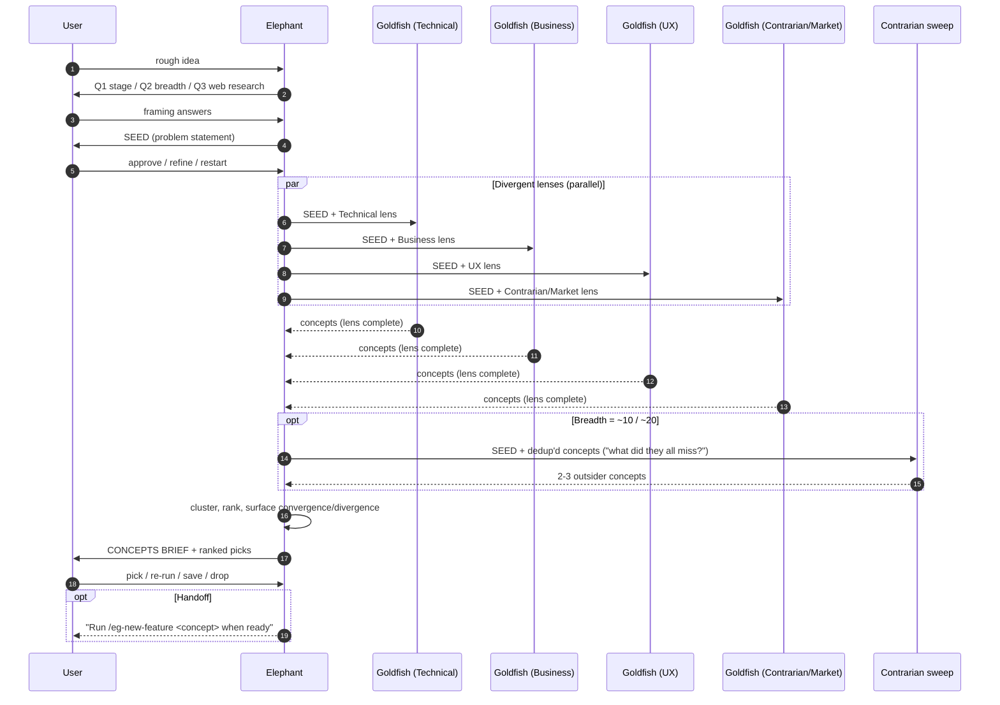
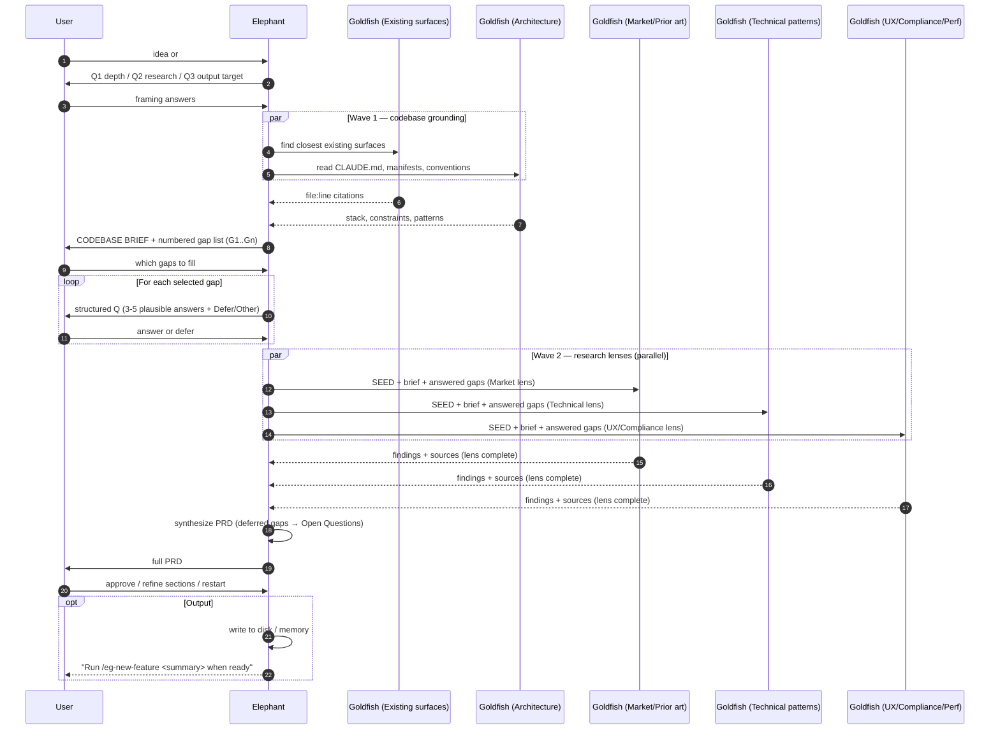
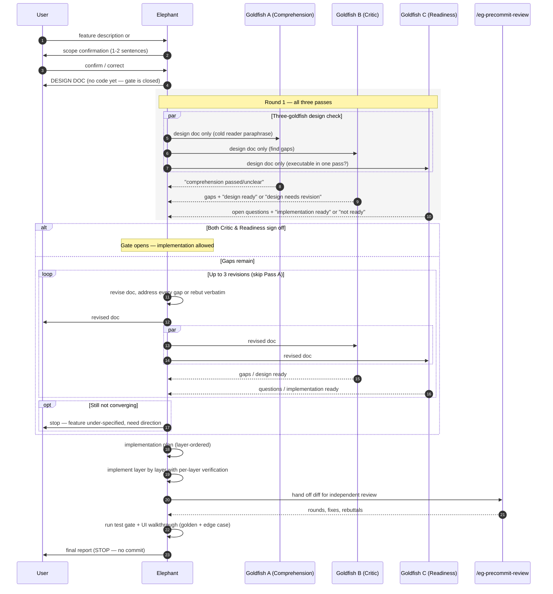
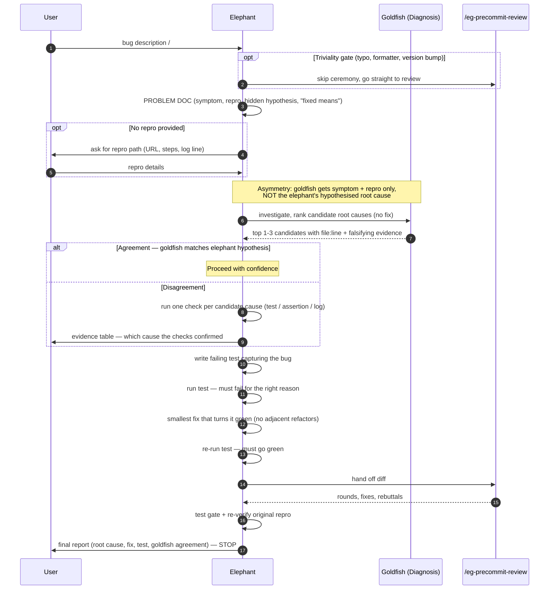

# Elephant/Goldfish

A workflow for Claude Code, Codex and Gemini CLI where **fresh-context subagents check your work before you commit**: they diagnose the bug independently, stress-test the design doc, and review the diff without knowing what you meant to do.

Based on the elephant/goldfish pattern from [Dave Rensin's article](https://drensin.medium.com/elephants-goldfish-and-the-new-golden-age-of-software-engineering-c33641a48874).

---

## Why?

AI agents write code fast, and they review their own code badly: the session that wrote the code shares every assumption it made. A fresh agent that only sees the bug report, the design doc or the diff doesn't share those assumptions, so it catches what the first one missed.

> You're shifting the pipeline from "write me the code" to "think about what I missed, get a second opinion, collaborate, then write and test".

The cost is more tokens and longer runs. `/eg-stats` shows whether it's paying off for your project.

## Key features

- **The reviewer can't see your intent.** It reads the diff only: no commit messages, PR text or design docs.
- **Works on any default branch.** The base branch is detected (`main`, `master`, `develop`, ...) instead of assumed.
- **Safe lint baseline.** "Is this error new?" is answered with a temporary worktree at the merge-base; your working files are never stashed or reset.
- **A different model for the goldfish.** Goldfish run on a configurable model (default `sonnet`), and optionally get a second opinion from Codex or Gemini CLI, so they don't share the main session's blind spots.
- **Disagreements are settled by evidence.** When the goldfish and the main session disagree on a bug's cause, both theories get a quick check, and the results decide.
- **Parallel reviewers by lens.** Larger diffs get bugs, security and test-coverage reviewers in parallel, with findings ranked by severity and confidence.
- **Cost tracking.** Each goldfish run is logged to `.eg/log.jsonl`; `/eg-stats` shows which passes change outcomes and which just cost tokens.
- **One config file, no rewritten commands.** Project settings live in `.eg/config.md`, shared by Claude Code, Codex and Gemini CLI. The commands themselves are never edited, so updating is a reinstall.
- **Claude Code plugin.** Install once, update with `/plugin update`.
- **One source for shared prompts.** The goldfish prompts live in `shared/` and are copied into each tool's files by `scripts/sync_shared.py`; CI fails if they drift.

## How to install

### Claude Code (plugin, recommended)

In Claude Code, run:

```
/plugin marketplace add Raj9914/elephant-goldfish
/plugin install elephant-goldfish@elephant-goldfish
```

Restart Claude Code, open your project, and run:

```
/eg-setup
```

It inspects your stack and writes `.eg/config.md` (you confirm it first), adds `.eg/log.jsonl` to `.gitignore`, and adds a short section to `CLAUDE.md`. Then type `/eg-` to see all commands.

### Claude Code (copy into one repo)

If you'd rather commit the commands into a repo for your team, open Claude Code in that repo and paste:

```
Fetch the elephant-goldfish bootstrap procedure with
`gh api repos/Raj9914/elephant-goldfish/contents/claude/BOOTSTRAP.md -H 'Accept: application/vnd.github.raw'`,
then follow the procedure to set up the elephant/goldfish workflow here, preserving any existing setups for other AIs.
```

### Codex (beta)

In your project, open a Codex session and paste:

```
Fetch the Codex elephant-goldfish bootstrap procedure with
`gh api repos/Raj9914/elephant-goldfish/contents/codex/BOOTSTRAP.md -H 'Accept: application/vnd.github.raw'`,
then follow the procedure to set up the Codex elephant/goldfish workflow here, preserving any existing setups for other AIs.
```

You'll get a set of `$eg-*` skills.

### Gemini CLI (beta)

In your project, open a Gemini CLI session and paste:

```
Fetch the Gemini CLI elephant-goldfish bootstrap procedure with
`gh api repos/Raj9914/elephant-goldfish/contents/gemini/BOOTSTRAP.md -H 'Accept: application/vnd.github.raw'`,
then follow the procedure to set up the Gemini CLI elephant/goldfish workflow here, preserving any existing setups for other AIs.
```

Then run `/skills reload` and type `/eg` to see the skills.

*Installs are additive and can live side by side. All three tools read the same `.eg/config.md`.*

---

## Project config: `.eg/config.md`

Everything project-specific lives in this one file (template: [shared/eg-config.template.md](shared/eg-config.template.md)):

| Section | What it holds |
|---|---|
| Project | name, default branch (auto-detected if empty), where docs, brainstorms and PRDs are saved |
| Commands | lint, typecheck, unit/e2e tests, security scan, codegen, dev server |
| Validation | web / mobile / backend, and which tool drives the UI |
| Test tiers | which test folder is for what |
| Review hunt list | stack-specific bugs the reviewer must look for (e.g. N+1 queries, missing tenant scoping) |
| Design rubric | stack-specific questions the design critic must ask |
| Implementation order, per-layer verification, always verify | how features get built and checked |
| Commit policy | message convention and rules |
| Goldfish | model, second opinion (codex/gemini), review lenses, parallel-review threshold, log path |

Commit `.eg/config.md` so your team shares it. `.eg/log.jsonl` is personal and git-ignored.

## Updating

- Claude Code plugin: `/plugin update elephant-goldfish`
- Project-local Claude install, Codex, Gemini: re-run the bootstrap prompt. Commands are copied unchanged; `.eg/config.md` is kept.

---

## What you get

| Stage | Claude Code | Codex | Gemini CLI |
|---|---|---|---|
| Brainstorm | `/eg-brainstorm` | `Use $eg-brainstorm ...` | `eg-brainstorm` Skill |
| PRD | `/eg-prd` | `Use $eg-prd ...` | `eg-prd` Skill |
| Bug fix | `/eg-fix-bug` | `Use $eg-fix-bug ...` | `eg-fix-bug` Skill |
| New feature | `/eg-new-feature` | `Use $eg-new-feature ...` | `eg-new-feature` Skill |
| Precommit review | `/eg-precommit-review` | `Use $eg-precommit-review ...` | `eg-precommit-review` Skill |
| Cost/value report | `/eg-stats` | | |
| Project config | `/eg-setup` | bootstrap | bootstrap |

With the plugin, full command names are `/elephant-goldfish:eg-…`; the short `/eg-…` names work when no other command uses them.

---

## The pattern

### Elephant

Your working session: Claude Code, Codex, or Gemini CLI with full context — this conversation, the repo instructions (`CLAUDE.md`, `AGENTS.md`, or `GEMINI.md`), files read in recent turns, and decisions already made together. The elephant carries the institutional memory.

### Goldfish

A fresh subagent spawned with no prior context. It receives only what you hand it: a problem statement, a design doc, or a diff. It has no idea what you've been thinking. That's the point.

### The asymmetry is the test

If a goldfish, given only the problem statement, lands somewhere different from where the elephant started, that disagreement is the cheapest signal you'll get that you were anchored. If a goldfish, given only the design doc, can't implement the same thing you intended, the doc is wrong — not the goldfish. **Design is the new code.** When AI generates more code than humans can review, the human-readable doc becomes the primary artifact, and a fresh reader who can act on it alone is the cheapest correctness check available.

---

## The pipeline

> `eg-brainstorm` produces a **concept**. `eg-prd` turns a concept into **requirements**. `eg-new-feature` and `eg-fix-bug` produce **code**. `eg-precommit-review` produces **validated code**. Each upstream stage feeds the next.



You don't have to start at the top. Pick the stage that matches what you have:

| You have | Start with | The output |
|---|---|---|
| A half-formed thought, no direction yet | `eg-brainstorm` | A concepts brief; pick a direction. |
| A direction but no requirements | `eg-prd` | A PRD: scope, users, metrics, open questions. |
| A clear feature to build | `eg-new-feature` | Implemented + reviewed code, ready to commit. |
| A bug or a `#<issue>` | `eg-fix-bug` | A failing-test-driven fix, ready to commit. |
| A diff already in hand | `eg-precommit-review` | A reviewer-cleared diff, ready to commit. |

### How each stage uses the pattern

**`eg-brainstorm`** inverts the pattern. Instead of one goldfish stress-testing the elephant, multiple goldfish run in parallel — each with a different lens (technical, business, UX, contrarian, market research) — to generate divergent ideas the elephant synthesizes into a concepts brief. Agents use structured clarifying questions (`AskUserQuestion`, `ask_user`, or structured prompts) to interact with the user.

**`eg-prd`** uses two waves of goldfish. First, exploration goldfish ground the request in the existing codebase. Then, after structured gap-filling Q&A with the user, research goldfish run in parallel across distinct lenses. The elephant synthesizes a PRD with explicit Open Questions for whatever the user deferred.

**`eg-new-feature`** uses three goldfish per round to stress-test the design doc the elephant drafted, mirroring the article's full design-stage protocol: comprehension (does the doc read cleanly to a cold reader?), critic (what gaps?), and readiness (could a first-pass implementer ship this without asking any questions?). A round passes only when both critic and readiness sign off; comprehension is informational. Round 2+ skips comprehension. Implementation only starts after the doc passes both gates. Then the same diff goes through `eg-precommit-review`.

**`eg-fix-bug`** uses one goldfish to diagnose the bug from only the symptom and repro. The elephant's hypothesis stays hidden until after the goldfish reports. If they disagree, the elephant doesn't get to just pick: each candidate cause gets a small check (test, assertion, log line) and the results decide. The bug gets captured as a failing test before any fix is written.

**`eg-precommit-review`** is itself a goldfish. It sees only the diff: not the conversation, and not the commit messages. On larger diffs several reviewers run in parallel, each with one lens (bugs, security, tests). Findings come back ranked by severity and confidence and are triaged round by round, with a hard cap and a structured user escalation if the loop doesn't converge.

---

## Commands And Skills

| Intent | Claude Code | Codex | Gemini CLI |
|---|---|---|---|
| Early-stage concept design | `/eg-brainstorm <rough idea>` | `Use $eg-brainstorm to brainstorm <rough idea>` | Invoke `eg-brainstorm` skill |
| PRD from idea / feature / issue | `/eg-prd <idea \| feature \| #issue>` | `Use $eg-prd to write a PRD for <idea \| feature \| #issue>` | Invoke `eg-prd` skill |
| Bug fix flow | `/eg-fix-bug <description \| #issue \| URL>` | `Use $eg-fix-bug to fix <description \| #issue \| URL>` | Invoke `eg-fix-bug` skill |
| Feature flow | `/eg-new-feature <description \| #issue \| URL>` | `Use $eg-new-feature to build <description \| #issue \| URL>` | Invoke `eg-new-feature` skill |
| Independent diff review | `/eg-precommit-review` | `Use $eg-precommit-review to review my pending changes` | Invoke `eg-precommit-review` skill |
| Is it worth the cost? | `/eg-stats` | read `.eg/log.jsonl` | read `.eg/log.jsonl` |
| Create / refresh project config | `/eg-setup` | Codex bootstrap, step 2b | Gemini bootstrap, step 2 |

Implementation flows (`eg-fix-bug`, `eg-new-feature`) stop short of committing. The user authorizes the commit explicitly when ready.

Codex note: current Codex builds do not support project-defined custom slash commands, so `/eg-*` and `/elephant-goldfish-codex:eg-*` are not expected to appear in the slash-command menu. Use `$eg-*` skill mentions instead.

You give a one-liner; the agent writes the doc back at you. **You don't author docs by hand.** Most docs live in chat. They land on disk only when there's a future-you reason to keep them — a substantial feature, a new subsystem, a saved brainstorm brief, a PRD that will be revisited.

---

## Workflows

Each command structures a different elephant↔goldfish dance. The diagrams below show the message flow for each. The **elephant** is your working session — full context, institutional memory. A **goldfish** is a fresh subagent spawned with no shared context, receiving only what the elephant hands it. The **user** is you, kept in the loop via structured questions (`AskUserQuestion`) at decision points.

### `eg-brainstorm`

**Inverts the pattern.** Instead of one goldfish stress-testing the elephant, multiple goldfish run in **parallel**, each on a different lens (technical, business, UX, contrarian, market research). Their lack of shared context is what makes them generate divergent ideas. The elephant synthesizes the divergent output into a concepts brief and helps the user converge on a direction.

**Output:** a clusters → ranked picks → open questions brief; optional handoff to `/eg-new-feature`.



---

### `eg-prd`

**Two waves of goldfish.** Wave 1 grounds the request in the existing codebase (parallel exploration goldfish). Wave 2 — after structured gap-filling Q&A with the user — runs research goldfish in parallel across distinct lenses. The elephant synthesizes a PRD with explicit Open Questions for whatever the user deferred.

**Output:** a PRD (executive summary, scope, requirements, metrics, risks, open questions, sources); optional save to disk and/or handoff to `/eg-new-feature`.



---

### `eg-new-feature`

**Three goldfish per round** stress-test the design doc the elephant drafted. Comprehension (does the doc read cleanly to a cold reader?), Critic (what gaps?), Readiness (could a first-pass implementer ship this without asking any questions?). A **no-code gate** holds until BOTH Critic and Readiness sign off (`design ready` + `implementation ready`). Round 2+ skips Comprehension. Implementation only starts after the gate closes; then the diff goes through `/eg-precommit-review`.

**Output:** implemented + reviewed code, ready for the user to commit.



---

### `eg-fix-bug`

**One goldfish diagnoses the bug** from only the symptom + repro. The elephant's hypothesis stays hidden until after the goldfish reports. Agreement buys confidence; disagreement is settled by running a check for each candidate cause, not by the elephant's judgement. The bug gets captured as a **failing test before any fix is written**. Then the same diff goes through `/eg-precommit-review`.

**Output:** failing-test-driven fix, ready for the user to commit.



---

### `eg-precommit-review`

**The reviewer is itself a goldfish.** It sees only the diff: not the conversation, not the commit messages, not what the elephant was trying to do. On round 1 of a larger diff, one reviewer per lens (bugs, security, tests) runs in parallel, optionally plus a second opinion from Codex or Gemini CLI. Findings are triaged round by round: **fix or rebut verbatim** (no silent dismissals). The loop runs until `no findings` AND every prior-round finding is settled, with a **hard cap of 5 rounds** and structured user escalation if it doesn't converge.

**Output:** a reviewer-cleared diff with every rebuttal surfaced verbatim to the user.

```mermaid
sequenceDiagram
    autonumber
    participant U as User
    participant E as Elephant
    participant GR as Goldfish (Reviewer)

    Note over E: Detect base branch. Pre-flight: lint, typecheck, unit, e2e, codegen<br/>(not chained; only errors new vs. a clean base worktree are blockers)

    rect rgb(245,245,245)
    Note over E,GR: Loop — hard cap 5 rounds
    loop Round N
        E->>GR: EXACT template (no intent leakage) + focus area if any
        Note over GR: Reads git status / diff / diff --cached /<br/>diff base...HEAD (no commit messages), reads touched files in full
        GR-->>E: numbered findings (file:line + why + fix) OR "no findings"
        E->>E: triage each finding — fix or rebut verbatim
        E->>U: ledger — open findings going into round N+1
        opt All settled AND "no findings"
            Note over E: Exit loop
        end
    end
    end

    alt Hit 5-round cap or repeat finding at same file:method
        E->>U: AskUserQuestion — accept / keep working / abandon
        U->>E: choice
    end

    E->>U: final report (rounds, fixes, rebuttals VERBATIM) — STOP, no commit
```

---

## Project-specific commands and skills

Some projects need a stack-specific verb the generic workflows don't cover, for example `eg-new-plugin` for a project that ships modular plugins, or `eg-new-migration` for a schema-heavy SaaS.

1. Copy `eg-new-feature` from the relevant adapter as the starting shape.
2. Replace the design rubric with the project-specific recipe (invariants, the canonical "how to add one of these" steps, the verification path).
3. Mention it in your project instruction file so users and agents know when to use it.

Use the `eg-` prefix so the set stays easy to find and doesn't collide with generic verbs like `/prd`.

---

## Contributing

- Goldfish prompts shared by all three tools live in [shared/prompts/](shared/prompts/) and [shared/procedures/](shared/procedures/). Edit them there, then run `python3 scripts/sync_shared.py` to copy them into the Claude, Codex and Gemini files. CI runs `--check` and fails if any copy is out of date.
- Tool-specific steps live in `claude/commands/`, `codex/skills/` and `gemini/commands/`.
- `claude/` is also the Claude Code plugin root; validate with `claude plugin validate claude` and `claude plugin validate .`.

---

## License

MIT. See [LICENSE](LICENSE).
